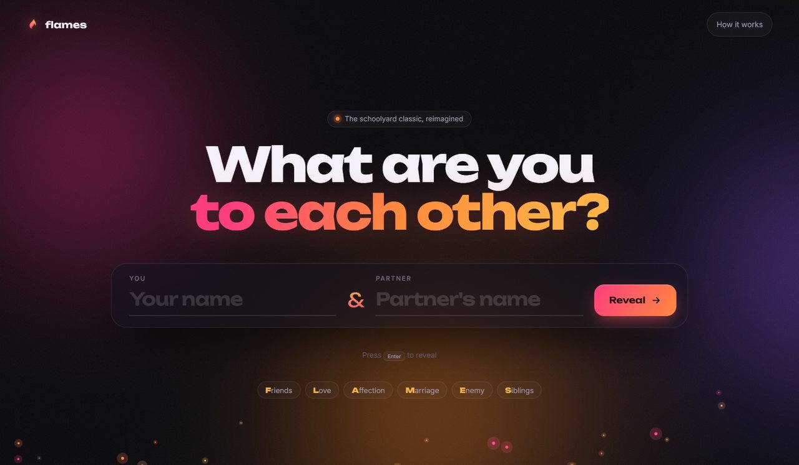
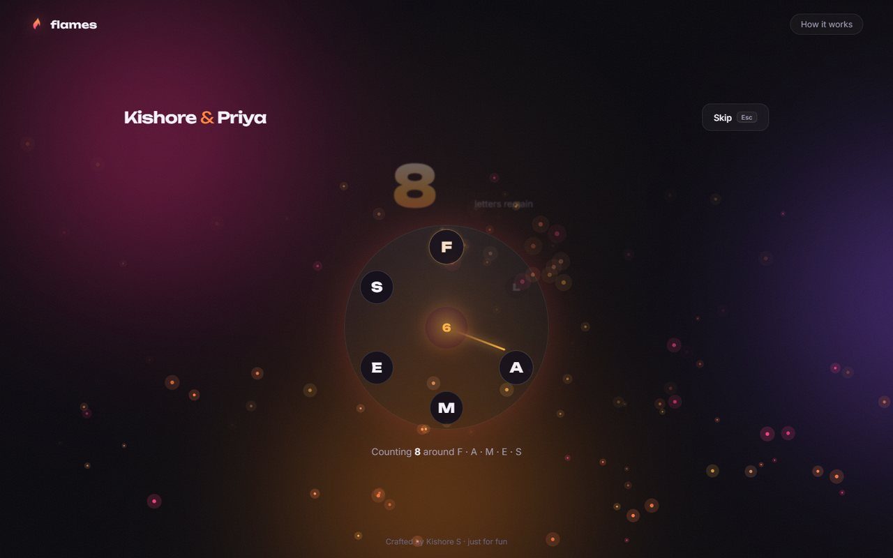
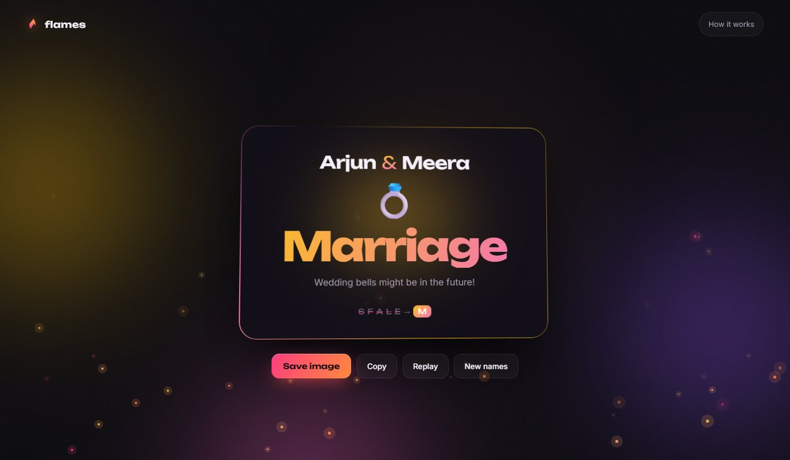
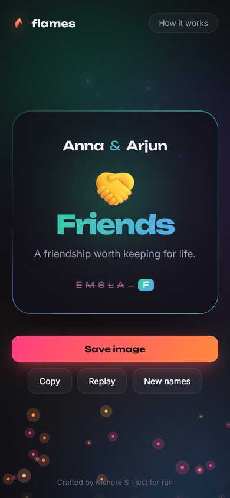

# FLAMES

[](https://github.com/Kishore-1011/flames-calculator/actions/workflows/tests.yml)


**Live demo: https://kishore-1011.github.io/flames-calculator/**

The schoolyard name game, reimagined as a cinematic web experience. Enter two names and watch the letters literally burn away until one of **F**riends, **L**ove, **A**ffection, **M**arriage, **E**nemy or **S**iblings survives.



## The reveal

Every result is played out step by step, so you can see exactly how the answer is reached:

1. **The letters you share ignite.** Each letter both names have in common lights up and burns away in a burst of embers.
2. **The count.** A counter climbs to the number of letters left.
3. **The wheel.** F-L-A-M-E-S sit on a wheel. A glowing hand counts around it, one letter per step, and the letter it lands on bursts into flame. This repeats until one letter is left.
4. **The survivor.** The last letter flies to the centre and the result card appears in its own colours.

| Counting around the wheel | The result |
|---|---|
|  |  |

## Features

- **Atmosphere:** drifting aurora light, film grain, a cursor spotlight and rising embers drawn on a canvas that drift away from the pointer
- **Results with personality:** each result has its own colour theme, emoji and message, on a card with an animated gradient border and a 3D tilt that follows the mouse
- **Share image:** downloads a 1080 × 1350 image of your result, sized for stories and status updates (on phones it opens the share sheet)
- **Copy, Replay and New names** buttons, plus **Skip** (or <kbd>Esc</kbd>) at any point of the reveal
- **Private by design:** names and results are never stored or sent anywhere; everything runs in your browser and is gone when you close the page
- **How it works** panel explaining the rules
- **Keyboard friendly:** <kbd>Enter</kbd> in the first field moves to the second, <kbd>Enter</kbd> again reveals
- **Accessible:** the result is announced to screen readers, and the *reduce motion* setting skips straight to the answer with no particles
- **Responsive** layout from phones to large screens
- **No build step, no dependencies:** plain HTML, CSS and JavaScript



## How FLAMES works

Take *Arjun* and *Meera*. They share an **a** and an **r**, which cancel out, leaving 6 letters. Starting at F, count 6 letters around F-L-A-M-E-S and cross out the one you land on, then keep counting from the next letter. The letters burn in the order S, F, A, L, E, so **M (Marriage)** survives.

Spaces, digits and symbols are ignored. If two names cancel out completely, the app suggests trying full names.

## Run it

Open `index.html` in a browser, or serve the folder:

```bash
python -m http.server 8000
```

Then visit http://localhost:8000.

## Tests

The rules live in `logic.js` as pure functions, separate from the page code in `app.js`. Nine unit tests use Node's built-in test runner:

```bash
node --test
```

They cover letter matching (including repeated letters), the elimination order, every count from 1 to 60, the step data that drives the wheel animation, known name pairs, and names that cancel out. The tests run on GitHub Actions on every push.

## Project structure

```
flames-calculator/
├── index.html              # Page markup: names, reveal and result views
├── style.css               # Design system, layout and animations
├── logic.js                # FLAMES rules (pure functions, tested)
├── app.js                  # Embers, the four-act reveal and sharing
├── tests/flames.test.js    # Unit tests (node --test)
└── docs/                   # Screenshots
```

## Background

I first built this in 2023 as a simple two-field form with a typing effect. In 2026 I rebuilt it as a full interactive experience: a new visual design, the animated step-by-step reveal, a share image, accessibility support and a tested logic module.

*Just for fun. Please don't make life decisions based on it.* 😉
